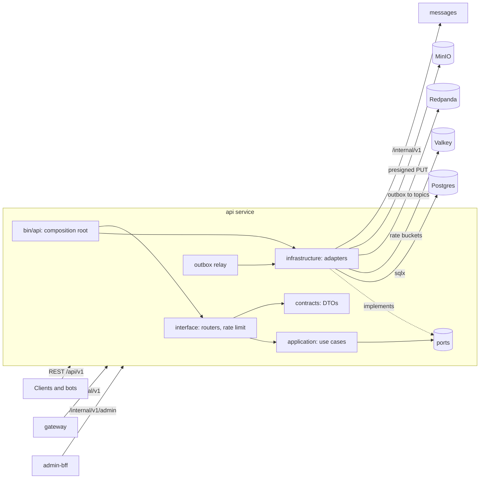

# Architecture

The api service owns accounts, guilds, channels, roles, members, invites, emojis, the audit log, applications, bots, commands, interactions and webhooks. Messages, gateway and voice are other services; api reaches the messages service over its internal API and publishes P6 events that the gateway fans out.

Moderation: `POST /guilds/{id}/roles/{role_id}/duplicate` copies a role (name "X (copy)") to the position just below the source, shifting the source and the roles above it up one; it needs MANAGE_ROLES, the hierarchy check and the permissions being copied, and writes a ROLE_CREATE audit entry. `guilds.prune_admin_only` is the stored setting that restricts member pruning to administrators; api has no prune endpoint yet, so the setting is not enforced anywhere. `GET /guilds/{id}/audit-logs?target_id=` returns the entries about one user, and the response `users` hold their summaries even after they left or were banned (the lookup reads the users table, not the member list).
System messages are posted best effort through the messages internal API: group DM changes (types 1, 2, 4, 5), a member joining a guild (type 7, into `system_channel_id` unless `system_channel_flags` bit 0 suppresses it) and a thread being created (type 18, in the parent channel). A failed post is logged and never fails the join or the thread.

## Layers

The crates follow Clean Architecture. Dependencies point inward only.

| Crate | Responsibility |
|---|---|
| `domain` | Entities, permission calculator, delivery-mode resolver, Snowflakes, validation. No IO. |
| `application` | Use cases, port traits, the write set (`Mutation` + `DomainEvent`). No HTTP, SQL or Kafka. |
| `infrastructure` | Adapters: sqlx Postgres repositories and unit of work, transactional outbox and relay, rskafka publisher, argon2, EdDSA JWTs, TOTP, secrets, Snowflake clock, Valkey rate limiter, MinIO storage, messages HTTP client. |
| `interface` | axum routers, extractors, Discord-style error bodies, rate limit middleware. Handlers translate between the wire and use cases. |
| `contracts` | Wire DTOs and the P6 envelope, isolated so they can be swapped for the generated contracts package. |
| `bin/api` | Composition root: configuration, adapter wiring, outbox relay task, telemetry, HTTP server. |

## Components

## Consistency

Every state change is a `WriteSet`: mutations and the events they produce are committed in one Postgres transaction. Events become outbox rows with a UUIDv7 `id`; the relay claims rows with `FOR UPDATE SKIP LOCKED`, publishes them to Redpanda keyed by the P6 partition key, and marks them sent. Delivery is at least once, so consumers deduplicate on the envelope `id`.

Ephemeral events that need no durability (typing) are published directly through `KafkaEvents`.

## Rate limiting

Per identity (hash of the credential, or the forwarded address) and per route bucket, a token bucket in Valkey is checked and updated by a single Lua script. Responses carry `X-RateLimit-*`; exhausted callers get `429` with `Retry-After`. A Valkey outage fails open.

## Testing

- Unit tests live beside the code (domain rules, serialization, adapters that need no IO).
- Integration tests use testcontainers: Postgres for repositories, migrations, the unit of work and HTTP contract tests; Redpanda for the relay; Valkey for the limiter.
