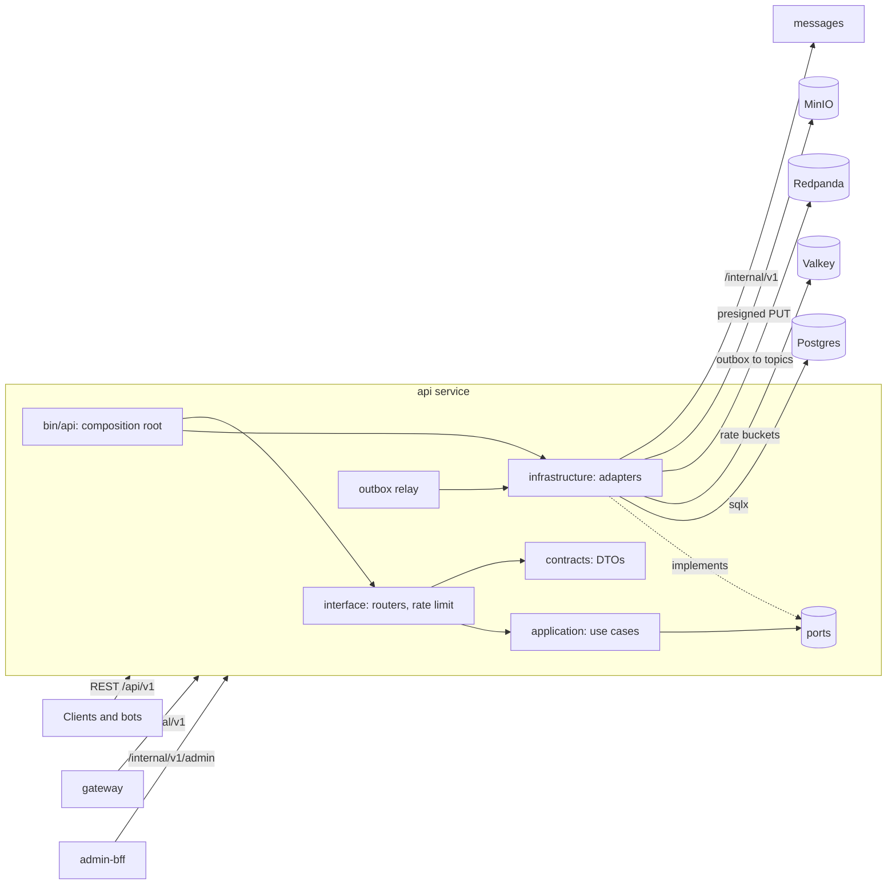

# Architecture

The api service owns accounts, guilds, channels, roles, members, invites, emojis, the audit log, applications, bots, commands, interactions and webhooks. Messages, gateway and voice are other services; api reaches the messages service over its internal API and publishes P6 events that the gateway fans out.

Moderation: `POST /guilds/{id}/roles/{role_id}/duplicate` copies a role (name "X (copy)") to the position just below the source, shifting the source and the roles above it up one; it needs MANAGE_ROLES, the hierarchy check and the permissions being copied, and writes a ROLE_CREATE audit entry. `GET /guilds/{id}/prune?days=&include_roles=` counts and `POST /guilds/{id}/prune` removes (one MEMBER_PRUNE audit entry with `members_removed`) the members who joined more than `days` (1-30, default 7) ago, have no login session used within that window and hold no role besides the included ones. The owner, bots and members the caller does not outrank are never pruned. It needs KICK_MEMBERS, or ADMINISTRATOR when `guilds.prune_admin_only` is set. `GET /guilds/{id}/audit-logs?target_id=` returns the entries about one user, and the response `users` hold their summaries even after they left or were banned (the lookup reads the users table, not the member list).

System messages are posted best effort through the messages internal API: group DM changes (types 1, 2, 4, 5), a member joining a guild (type 7, into `system_channel_id` unless `system_channel_flags` bit 0 suppresses it) and a thread being created (type 18, in the parent channel). A failed post is logged and never fails the join or the thread. Group DMs hold at most `GROUP_DM_MAX_PARTICIPANTS` members (default 25), enforced when a group is created and when a recipient is added.

## Layers

The crates follow Clean Architecture. Dependencies point inward only.

| Crate | Responsibility |
|---|---|
| `domain` | Entities, permission calculator, delivery-mode resolver, Snowflakes, validation. No IO. |
| `application` | Use cases, port traits, the write set (`Mutation` + `DomainEvent`). No HTTP, SQL or Kafka. |
| `infrastructure` | Adapters: sqlx Postgres repositories and unit of work, transactional outbox and relay, rskafka publisher, argon2, EdDSA JWTs, TOTP, secrets, Snowflake clock, Valkey rate limiter, MinIO storage, messages HTTP client. |
| `interface` | axum routers, extractors, Discord-style error bodies, rate limit middleware. Handlers translate between the wire and use cases. |
| `contracts` | Wire DTOs and the P6 envelope, isolated so they can be swapped for the generated contracts package. |
| `bin/api` | Composition root: configuration, adapter wiring, outbox relay task, telemetry, HTTP server. |

## Components

## Consistency

Every state change is a `WriteSet`: mutations and the events they produce are committed in one Postgres transaction. Events become outbox rows with a UUIDv7 `id`; the relay claims rows with `FOR UPDATE SKIP LOCKED`, publishes them to Redpanda keyed by the P6 partition key, and marks them sent. Delivery is at least once, so consumers deduplicate on the envelope `id`.

Ephemeral events that need no durability (typing) are published directly through `KafkaEvents`.

## Push tokens

The mobile app registers one APNs or FCM token per login session (`POST|DELETE /users/@me/devices/push`, table `push_tokens`). A token is removed with its session (logout, remote revoke, logout-all, suspension), with its E2EE device, when the provider rejects it (`DELETE /internal/v1/push-tokens`, called by the `notifier` in the messages repo) and when it was not refreshed for `DEVICE_MAX_IDLE_DAYS` (the stale-device prune). The app re-registers on every start, which is the refresh. `GET /internal/v1/channels/{id}/push-targets?author_id=` gives the notifier the members who can view the channel, are not the author and hold a token on a live session, with their effective level and mute (channel, category, guild, default), suppression flags, roles and whether a gateway session is live (`PresenceDirectory::live_ids`). Deciding who is pinged stays in the notifier. For a notification the owner sends by hand from the admin portal, `GET /internal/v1/users/{id}/push-tokens` returns one user's live notification tokens and `GET /internal/v1/push-tokens?after=&limit=` pages (by user id, `limit` 1..500, default 200, `next_after` until the last page) through everyone who holds one; both are read by the notifier only and skip PushKit tokens.

The iPhone app also registers a PushKit (VoIP) token per session (`POST|DELETE /users/@me/devices/voip`, table `voip_tokens`, migration 0020). It is a different token from the notification token, issued without any notification permission, and it only rings the phone for an incoming DM call (the notifier sends it as an APNs `voip` push). It follows the same lifecycle as the notification token of its session: removed on logout, revoke, suspension and by the stale prune, and removed when APNs rejects it (`DELETE /internal/v1/push-tokens` deletes the token from both tables, since VoIP tokens are APNs only). `push-targets` lists a member who holds only a VoIP token (every target carries `tokens` and `voip_tokens`).

## Reports

`POST /api/v1/reports` (not under `/channels/{id}/messages`, which the ingress sends to messages) files a report of a message (`target: "message"`, `channel_id`, `message_id`) or a user (`target: "user"`, `user_id`) with a `category` (spam, harassment, hate_speech, violence, sexual_content, self_harm, illegal, impersonation, other) and an optional note of at most 500 characters. The caller must be able to see the channel, cannot report themselves, and gets 204 with no body whether the report is new or a repeat (one open report per reporter and target, enforced by partial unique indexes), so a reporter learns nothing about other reports. A reporter may file 10 reports an hour (`throttle`, key `report:{user}`).

For a Standard channel the use case reads the message from messages (`GET /internal/v1/channels/{id}/messages/{mid}`) and stores its author and content at report time (`content_source` = `server`); later edits or deletes do not change the report. Ephemeral and P2P content is never on the server, so the request must carry `author_id` (a member of the channel) and may carry `content` (at most 4000 characters, stored as `content_source` = `reporter`, unverified). Table `reports` (migration 0021) is only read through the admin internal API: `GET /internal/v1/admin/reports?status=&limit=&after=` and `POST /internal/v1/admin/reports/{id}/resolve` (`resolution` resolved or dismissed, `resolved_by`, optional note; an already closed report is a 409). No user-facing route reads reports, so the reported user never learns who reported them. There is no automatic retention yet: reports stay until deleted by an operator in the database.

## Rate limiting

Per identity (hash of the credential, or the forwarded address) and per route bucket, a token bucket in Valkey is checked and updated by a single Lua script. Responses carry `X-RateLimit-*`; exhausted callers get `429` with `Retry-After`. A Valkey outage fails open.

## Testing

- Unit tests live beside the code (domain rules, serialization, adapters that need no IO).
- Integration tests use testcontainers: Postgres for repositories, migrations, the unit of work and HTTP contract tests; Redpanda for the relay; Valkey for the limiter.
